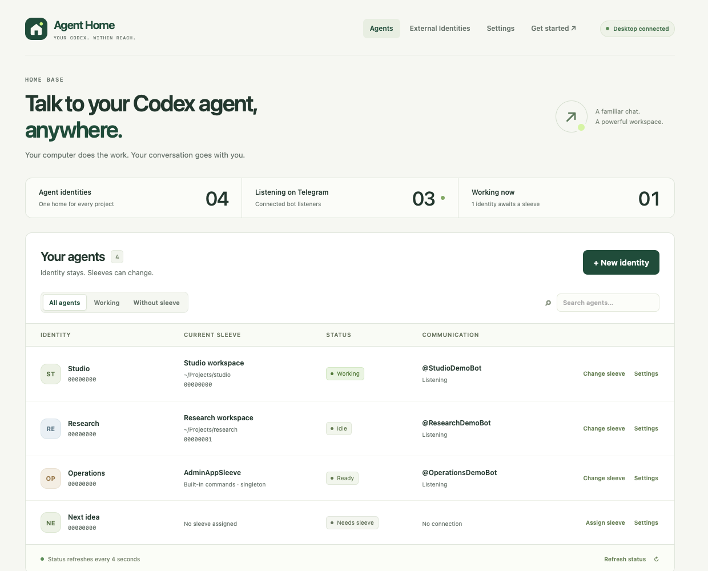

# Agent Home

**Talk to your Codex agent, anywhere.**

[Download for macOS](https://github.com/firstprayer/agent-home-public/releases/tag/v0.3.2) ·
[Website](https://firstprayer.github.io/agent-home-public/) ·
[User guide](docs/guide.md)

A free, open-source app that connects Telegram to Codex running on your computer.
Your computer does the work. Your conversation goes with you.

*Example workspace. Your own agents and sessions appear here.*

- **Continue the same session.** Message or steer your existing Codex root session
  from your phone.
- **Bring more than words.** Send photos, videos, and voice notes; receive local
  image and video attachments, including files outside the working folder by
  default. Each identity can restrict attachments to its workspace in its agent settings.
  Voice and video decoding use your agent's local tools.
- **Give every project a home.** Durable identities, separate Telegram bots,
  replaceable runtime sleeves, and visible connection status.
- **Stay in control.** Explicit sender access, local SQLite storage, and recovery
  of saved managed sessions. Create sleeves in configured folders from the Admin
  menu, or copy a complete terminal resume command from the desktop dashboard.

## Get started

1. Install and sign in to Codex CLI on your computer.
2. Download the [v0.3.2 macOS preview](https://github.com/firstprayer/agent-home-public/releases/tag/v0.3.2),
   drag **Agent Home** into Applications, then open it. Python and Node are not
   required for the download.
3. Follow **Get started** in the app: create an identity, assign a Codex sleeve,
   connect a BotFather token, and allow your Telegram account in **External Identities**.
4. Open your bot in Telegram and send your first message.

The DMG supports **Apple Silicon Macs on macOS 15 or later**. It is ad-hoc signed
and **not Apple notarized**; if macOS blocks it, review the release and follow
[Apple's Open Anyway instructions](https://support.apple.com/en-us/102445).
The download page includes SHA-256 checksums.

Keep your computer awake, online, and running Agent Home. Bring your own Codex
account and Telegram bot; model-provider charges remain separate. Incoming files
are limited to 20 MB. The app has no automatic updater or login startup.

Intel Mac users can [build from source](docs/development.md#macos-packaging).
The Python server also [runs on Linux](docs/guide.md#command-line).
Windows support is planned.

## Documentation

| Topic | Guide |
|---|---|
| Installation, settings, sleeves, Telegram access, Admin menus, media, recovery | [User guide](docs/guide.md) |
| Local HTTP endpoints, SQLite storage and migration | [API and storage reference](docs/api.md) |
| Tests, architecture, macOS packaging, website deployment and releases | [Development and publishing](docs/development.md) |
| Contribution rules and engineering invariants | [AGENTS.md](AGENTS.md) |

## License

Copyright © 2026 firstprayer. Agent Home is licensed under
[GNU AGPL version 3 only](LICENSE) (`AGPL-3.0-only`). Distributed modified versions
must provide corresponding source under the same license. Modified versions
that users interact with over a network must offer those users their
corresponding source as required by section 13. Commercial use is permitted.
Third-party components retain their respective licenses; see
[THIRD_PARTY_NOTICES.txt](THIRD_PARTY_NOTICES.txt).
